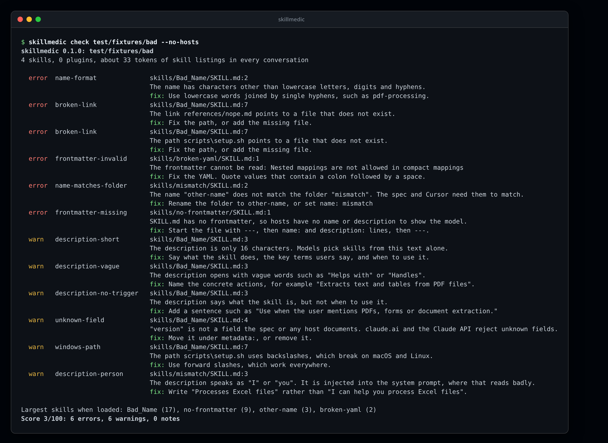
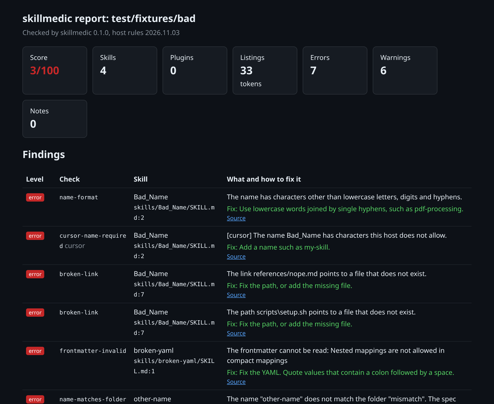
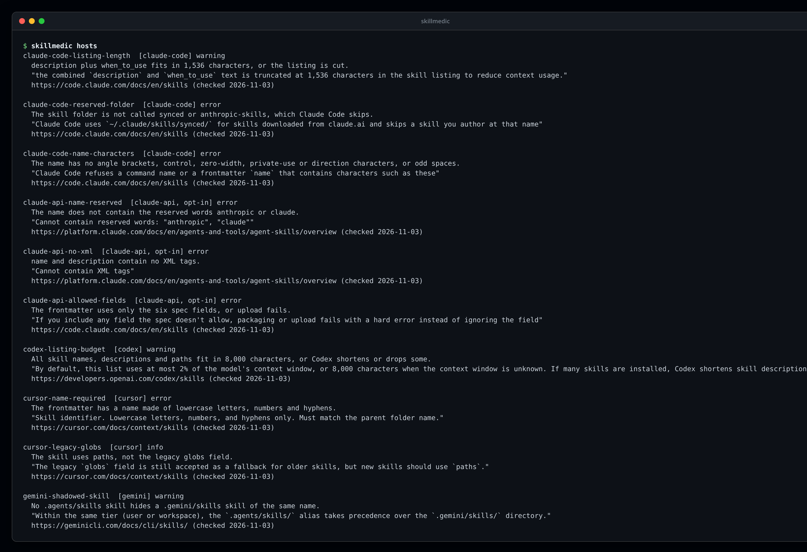
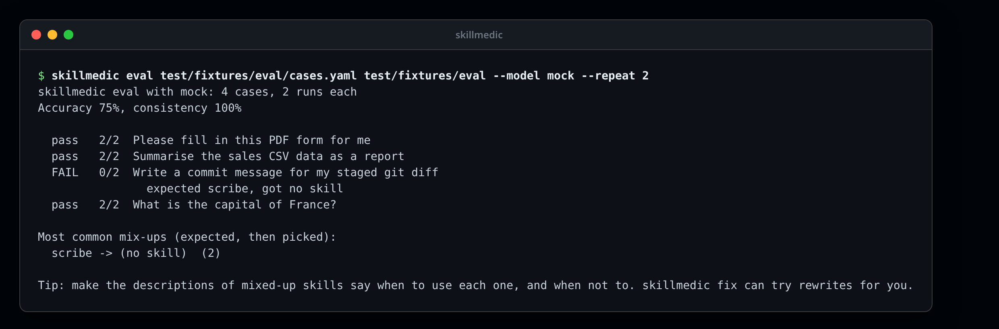
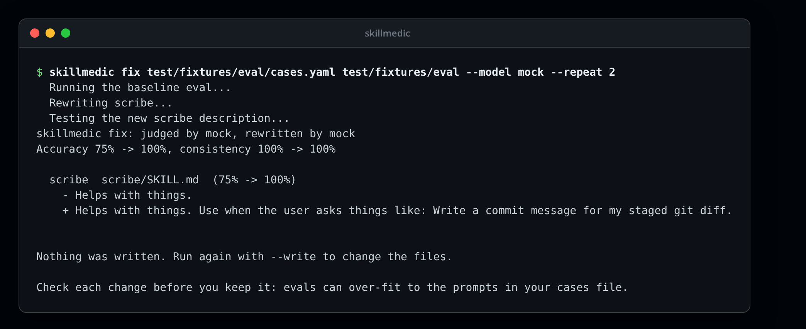

# skillmedic

Check your Agent Skills and plugins before your users do.

[](https://github.com/jmozez/skillmedic/actions/workflows/ci.yml)
[](https://github.com/jmozez/skillmedic/actions/workflows/codeql.yml)
[](LICENSE)

skillmedic finds the problems that stop an agent from picking or using your skill: a missing or broken frontmatter, a vague description, links to files that are not there, a body too long to load, scripts that cannot run, secrets, and hidden instructions. It knows the documented limits of Claude Code, the Claude API, OpenAI Codex, Cursor and Gemini CLI, and it can test with a real model whether the right skill is picked for each prompt.

It never runs a skill's scripts. See [SECURITY.md](SECURITY.md).



## Install

```sh
npx skillmedic check
```

Or install it with `npm install -g skillmedic`. Node 20 or later is needed.

## Check skills

```sh
skillmedic check                  # every SKILL.md and plugin manifest under the current folder
skillmedic check ./skills --json  # machine-readable report
skillmedic check --html report.html --sarif skillmedic.sarif --badge badge.json
skillmedic rules                  # list every check
```

skillmedic finds skills in any folder layout, including `.claude/skills`, `.agents/skills`, `.cursor/skills`, `.gemini/skills` and plugin `skills/` folders. It reads Claude Code plugins (`.claude-plugin/plugin.json`), Codex plugins (`.codex-plugin`), Cursor plugins (`.cursor-plugin`), Gemini CLI extensions (`gemini-extension.json`) and portable Agent Plugins.

Every report has a score out of 100 and an estimate of how many tokens your skill listings add to every conversation. Host rules show where a host differs from the Agent Skills spec; they do not change the score.

| Option | What it does |
| --- | --- |
| `--json` | Print the report as JSON. |
| `--html <file>` | Also write a single-page HTML report. |
| `--sarif <file>` | Also write SARIF 2.1.0 for GitHub code scanning. |
| `--badge <file>` | Also write a shields.io endpoint badge with the score. |
| `--fail-on <level>` | Exit 1 at this level or above: `error` (default), `warning`, `info` or `never`. |
| `--rule <id>` | Run only this check. Repeatable. |
| `--host <id>` | Run only this host's rules, including opt-in ones such as `claude-api`. Repeatable. |
| `--no-hosts` | Skip host rules. |
| `--max-files <n>` | Stop searching after this many files (default 20,000). |

Exit codes: `0` nothing at the `--fail-on` level, `1` findings at that level, `2` a usage or runtime error.



## Host rules

`skillmedic hosts` lists every host rule with the official page and the quote it is based on. The rules live in [hosts/hosts.yaml](hosts/hosts.yaml), and every entry records the date it was checked.



## Test skill choice with a model

A description is only good if a model picks the skill when it should. Write a cases file:

```yaml
cases:
  - prompt: Please fill in this PDF form for me
    expect: pdf-forms
  - prompt: What is the capital of France?
    expect: none
```

Then run:

```sh
export OPENAI_API_KEY=...   # keys come only from environment variables
skillmedic eval cases.yaml ./skills --model openai:gpt-4.1-mini --repeat 3
```

The model sees each skill's name and description, as a host lists them, and can load one skill or none. skillmedic reports accuracy, flaky cases that change between runs, and which skills get mixed up.

| Model | Environment variables |
| --- | --- |
| `openai:<model>` | `OPENAI_API_KEY`, optional `OPENAI_BASE_URL` |
| `anthropic:<model>` | `ANTHROPIC_API_KEY`, optional `ANTHROPIC_BASE_URL` |
| `openrouter:<model>` | `OPENROUTER_API_KEY` |
| `ollama:<model>` | optional `OLLAMA_HOST` |
| `compatible:<model>` | `SKILLMEDIC_BASE_URL`, optional `SKILLMEDIC_API_KEY` |
| `mock` | none; picks by word overlap, for trying things out |

Other options: `--repeat` (1 to 50), `--concurrency` (1 to 16), `--timeout` in seconds and `--min-accuracy` to fail CI below a percentage.



## Fix weak descriptions

```sh
skillmedic fix cases.yaml ./skills --model openai:gpt-4.1-mini          # suggestions only
skillmedic fix cases.yaml ./skills --model openai:gpt-4.1-mini --write  # change SKILL.md
```

`fix` asks a model to rewrite the descriptions of skills that are picked badly, runs the eval again, and keeps a rewrite only if accuracy goes up. Rewrites that trip the safety checks are dropped. Without `--write` nothing is changed. With it, only the `description` line changes; comments, line endings and the body are kept.



## GitHub Action

```yaml
permissions:
  contents: read
  security-events: write

steps:
  - uses: actions/checkout@<sha> # pin to a commit
    with:
      persist-credentials: false
  - uses: jmozez/skillmedic@64a0c3e09096241a26041e01f7f85547c875f6d9
    with:
      path: .
      fail-on: error
      sarif: skillmedic.sarif
  - uses: github/codeql-action/upload-sarif@<sha>
    if: always()
    with:
      sarif_file: skillmedic.sarif
```

Inputs: `path`, `fail-on`, `host` (comma-separated, or `none`), `args`, `html`, `badge` and `sarif`. Outputs: `score` and `report`. The step writes a summary to the job page.

## Library

```ts
import { discover, runRules, buildReport } from "skillmedic";

const project = discover("./skills");
const report = buildReport(project, runRules(project), "0.1.0");
console.log(report.score);
```

## Development

```sh
npm ci
npm run typecheck
npm test
npm run build && bash docs/images/make.sh   # rebuild the screenshots
```

See [CHANGELOG.md](CHANGELOG.md), [RELEASING.md](RELEASING.md) and [SECURITY.md](SECURITY.md).

## Licence

MIT, by Jimmy Moses ([jmozez](https://github.com/jmozez)).
